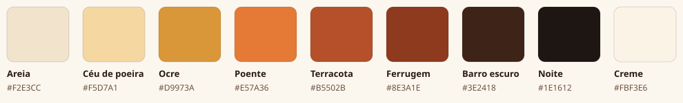

# libre-apps brand

The mark is a **calango**, the small lizard of the Brazilian semi-arid, seen from above and turned 45° clockwise, its tail curling under the body. The colors come from the same landscape: sand, ochre, terracotta and rust, the strata of a canyon at the end of the afternoon.

## Logo files

All in [`logo/`](logo/). Each is a single flat shape, with no outline or gradient.

| File | What it is | Use it for |
|---|---|---|
| `icon-terracota.svg` | Cream calango on a terracotta rounded square | **The primary logo.** Site header, favicon, app and social icons |
| `icon-terracota-square.svg` | The same, full-bleed square | Places that round or crop the corners themselves (Apple touch icon, GitHub avatar) |
| `icon-ocre.svg` | Clay calango on an ochre rounded square | Alternate |
| `icon-noite.svg` | Ochre calango on a night rounded square | Alternate, for dark backgrounds |
| `calango-terracota.svg` | The calango alone, terracotta | On light backgrounds, without the square |
| `calango-barro.svg` | The calango alone, clay | On light backgrounds, one-color printing |
| `calango-creme.svg` | The calango alone, cream | On dark or terracotta backgrounds |
| `calango-ocre.svg` | The calango alone, ochre | On dark backgrounds |
| `avatar-500.png` | `icon-terracota-square` at 500 × 500 px | The GitHub organization avatar |

The site serves its own copies in `assets/img/`: `mark.svg` (the primary logo), `icon-32.png` and `apple-touch-icon.png`.

Keep some room around the mark (at least a quarter of its width) and never stretch, outline, recolor outside the palette or add effects to it. Below 32 px the toes stop reading, but the shape still does.

## Palette

| Name | Hex | Where |
|---|---|---|
| Areia (sand) | `#F2E3CC` | Logo backgrounds and previews |
| Céu de poeira (dust sky) | `#F5D7A1` | Illustrations |
| Ocre (ochre) | `#D9973A` | Accent in the dark theme; `icon-ocre` |
| Poente (sunset) | `#E57A36` | Illustrations |
| Terracota | `#B5502B` | **Brand color.** Logo, accent in the light theme |
| Ferrugem (rust) | `#8E3A1E` | Links and small accent text in the light theme |
| Barro escuro (dark clay) | `#3E2418` | Calango on ochre |
| Noite (night) | `#1E1612` | Dark theme background; `icon-noite` |
| Creme (cream) | `#FBF3E6` | Calango on terracotta |

### Site tokens

`assets/css/site.css` defines these on `:root` (light, the default) and on `:root[data-theme="dark"]`:

| Token | Light | Dark | Role |
|---|---|---|---|
| `--paper` | `#F7EEDF` | `#1E1612` | Page background |
| `--paper-2` | `#EFE2CC` | `#251B16` | Alternate section background |
| `--card` | `#FCF7EE` | `#2A1F19` | Cards |
| `--ink` | `#2A1A12` | `#F3E7D8` | Text |
| `--ink-2` | `#6B5242` | `#BBA58F` | Secondary text |
| `--line` | `#E2D2B9` | `#3E2E24` | Borders and rules |
| `--accent` | `#B5502B` | `#D9973A` | Rules, the selected language, highlights |
| `--accent-ink` | `#8E3A1E` | `#E8B062` | Links and accent text |
| `--on-accent` | `#FFFFFF` | `#1E1612` | Text placed on `--accent` |

### Contrast

Measured as WCAG contrast ratios against the page background (`--paper`):

| Pair | Light | Dark |
|---|---|---|
| `--ink` | 14.5 | 14.6 |
| `--ink-2` | 6.3 | 7.5 |
| `--accent-ink` | 6.6 | 9.2 |
| `--on-accent` on `--accent` | 4.9 | 7.2 |

Terracotta on the light page is 4.4, under the 4.5 needed for body text: use it for shapes and rules, and rust (`--accent-ink`) for text.
